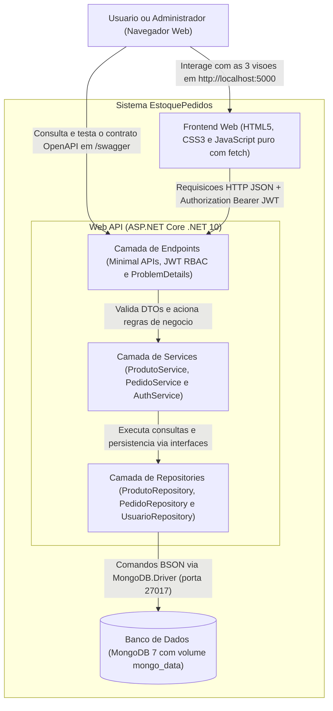

# Sistema de controle de estoque e pedidos

Aplicação web desenvolvida para a disciplina de Arquitetura de Aplicações Web (AAW). O sistema gerencia um catálogo de produtos de informática e escritório e o registro de pedidos de venda, mantendo o vínculo de um para muitos (`1:N`) entre produtos e pedidos, baixa e estorno automático de saldo em estoque, autenticação via JWT e controle de acesso por papel (RBAC).

## Domínio, entidades e regras de negócio

O banco de dados no MongoDB é organizado em três coleções principais:

- `Produto` (`produtos`): armazena `Id` (`ObjectId`), `Nome` (único no catálogo), `Categoria`, `Preco` (`Decimal128`), `Estoque`, `Ativo` e `CriadoEm`.
- `Pedido` (`pedidos`): armazena `Id` (`ObjectId`), `ProdutoId` (referência `1:N` para o produto vendido), `NomeProduto`, `NomeCliente`, `Quantidade`, `Cupom`, `Subtotal`, `Desconto`, `Frete`, `ValorTotal`, `Status` (`Confirmado` ou `Cancelado`) e `CriadoEm`.
- `Usuario` (`usuarios`): armazena `Id` (`ObjectId`), `Nome`, `Email` (único), `SenhaHash` (gerado com PBKDF2 / `Rfc2898DeriveBytes`, `SHA256`, salt aleatório de 16 bytes e 100 mil iterações) e `Role` (`Admin` ou `Usuario`).

As regras de negócio ficam isoladas na camada `Services` (`ProdutoService`, `PedidoService` e `AuthService`), nunca nos endpoints nem no frontend:

1. **Validações de entrada (`400 Bad Request` em `ProblemDetails`)**:
   - Produtos exigem nome e categoria preenchidos, `Preco > 0` e `Estoque >= 0`.
   - Pedidos exigem nome do cliente, `Quantidade > 0` e aceitam apenas o cupom opcional `"DESC10"` (qualquer outro código de cupom é rejeitado).
   - O registro de usuário exige senha com no mínimo 6 caracteres e perfil válido (`Admin` ou `Usuario`).
2. **Regras de integridade e conflito (`409 Conflict` em `ProblemDetails`)**:
   - Não é permitido cadastrar ou atualizar um produto com nome já existente no catálogo.
   - Um produto que já possui pedidos vinculados na coleção `pedidos` não pode ser excluído.
   - Pedidos para produtos inativos ou com quantidade superior ao estoque disponível são bloqueados antes da gravação.
   - Um pedido já cancelado não pode ser cancelado uma segunda vez.
3. **Cálculo comercial e movimentação de estoque (`PedidoService`)**:
   - `Subtotal = Preco * Quantidade`.
   - `Desconto`: aplica `10%` sobre o subtotal quando o cupom `"DESC10"` é informado ou quando a compra tem `Quantidade >= 10` unidades. Os dois critérios não acumulam 20%, respeitando o teto de 10%.
   - `Frete`: compras com valor após desconto maior ou igual a `R$ 100,00` têm frete grátis (`R$ 0,00`); valores abaixo de `R$ 100,00` pagam taxa fixa de `R$ 15,00`.
   - `ValorTotal = Subtotal - Desconto + Frete`.
   - A emissão de um pedido desconta a quantidade diretamente do estoque do produto; o cancelamento devolve a mesma quantidade ao estoque e altera o status para `"Cancelado"`.

## Arquitetura do sistema (diagrama C4 de containers)

O diagrama abaixo representa o nível 2 (Containers) do modelo C4, detalhando também a divisão interna em camadas da Web API:



## Stack tecnológica

- **Backend**: C# e ASP.NET Core Web API (.NET 10)
- **Banco de dados**: MongoDB 7 acessado via `MongoDB.Driver`
- **Autenticação e segurança**: JWT Bearer (`Microsoft.AspNetCore.Authentication.JwtBearer`), hash PBKDF2 (`SHA256`) e controle de acesso RBAC (`Admin` e `Usuario`)
- **Padronização de erros**: RFC 9457 / RFC 7807 (`ProblemDetails` em `application/problem+json`) para erros `400`, `401`, `403`, `404`, `409` e `500`
- **Documentação de contrato**: OpenAPI / Swagger UI (`Swashbuckle.AspNetCore`) com suporte a cabeçalho Bearer
- **Frontend**: HTML5 semântico, CSS3 responsivo (`360px` a `1280px` com Grid e Flexbox) e JavaScript puro assíncrono (`fetch()`) servido pela própria API em `wwwroot/`
- **Testes automatizados**: `xUnit` com dublês de repositório em memória (`FakeProdutoRepository` e `FakePedidoRepository`)
- **Conteinerização**: `Dockerfile` multi-stage e orquestração com `docker-compose.yml`

## Como executar o projeto

Os comandos abaixo devem ser executados a partir desta pasta (`aaw/trabalhos/trabalho-01/`).

### Opção 1: Execução completa via Docker Compose (recomendada)

Sobe o banco MongoDB e compila a imagem da API em containers integrados:

```bash
docker compose up --build
```

Para rodar em segundo plano:

```bash
docker compose up --build -d
```

### Opção 2: Execução via CLI local (.NET SDK)

1. Suba o container do MongoDB na porta `27017`:

```bash
docker compose up -d mongo
```

2. Compile a solução e execute os 15 casos de teste automatizados em `xUnit` (os testes unitários rodam em memória e não exigem o MongoDB ativo):

```bash
dotnet build
dotnet test
```

3. Inicie a aplicação web:

```bash
dotnet run --project src/EstoquePedidos.Api
```

### Endereços de acesso

- **Interface web (Frontend com as 3 visões)**: http://localhost:5000
- **Documentação interativa (Swagger UI)**: http://localhost:5000/swagger
- **Verificação de saúde (Healthcheck)**: http://localhost:5000/api/health

## Credenciais de teste (seed automático)

Na subida da aplicação, o `DatabaseSeeder` verifica se o banco está vazio e insere automaticamente 2 usuários de teste, 6 produtos iniciais e 3 pedidos vinculados. Na interface web, também há botões de preenchimento rápido no topo da página:

| Perfil (Role) | E-mail | Senha | Permissões principais |
| :--- | :--- | :--- | :--- |
| `Admin` | `admin@estoquepedidos.com` | `Admin@123` | Acesso total: cadastrar, editar e excluir produtos, listar/emitir pedidos e cancelar pedidos estornando estoque |
| `Usuario` | `cliente@estoquepedidos.com` | `Cliente@123` | Consultar catálogo e ficha 1:N, listar pedidos e emitir novos pedidos (recebe `403 Forbidden` em rotas exclusivas de `Admin`) |

## Endpoints da API RESTful

Todas as rotas de erro devolvem `application/problem+json` no padrão `ProblemDetails`:

| # | Método | Rota | Perfil exigido | Códigos de status HTTP | Descrição |
| :---: | :--- | :--- | :--- | :--- | :--- |
| 01 | `POST` | `/api/auth/login` | Público | `200`, `401` | Autentica credenciais e retorna o token JWT |
| 02 | `POST` | `/api/auth/registro` | Público | `201`, `400`, `409` | Registra novo usuário com hash PBKDF2 e retorna o token JWT |
| 03 | `GET` | `/api/produtos` | Público | `200`, `400` | Lista produtos com filtro por `categoria`, `busca` por nome e paginação (`page`, `pageSize`) |
| 04 | `GET` | `/api/produtos/{id}` | Público | `200`, `404` | Obtém os dados cadastrais de um produto pelo `ObjectId` |
| 05 | `POST` | `/api/produtos` | `Admin` | `201`, `400`, `401`, `403`, `409` | Cadastra um novo produto no catálogo |
| 06 | `PUT` | `/api/produtos/{id}` | `Admin` | `200`, `400`, `401`, `403`, `404`, `409` | Atualiza dados, preço, estoque e situação de um produto |
| 07 | `DELETE` | `/api/produtos/{id}` | `Admin` | `204`, `401`, `403`, `404`, `409` | Remove um produto que não possua pedidos vinculados |
| 08 | `GET` | `/api/produtos/{id}/pedidos` | Público | `200`, `404` | Lista todos os pedidos vinculados a um produto específico (relacionamento `1:N`) |
| 09 | `GET` | `/api/pedidos` | `Usuario` ou `Admin` | `200`, `400`, `401` | Lista pedidos com filtro opcional por `status` e paginação |
| 10 | `GET` | `/api/pedidos/{id}` | `Usuario` ou `Admin` | `200`, `401`, `404` | Obtém os detalhes de um pedido específico |
| 11 | `POST` | `/api/pedidos` | `Usuario` ou `Admin` | `201`, `400`, `401`, `404`, `409` | Emite pedido calculando subtotal, desconto e frete e baixando o estoque |
| 12 | `DELETE` | `/api/pedidos/{id}` | `Admin` | `200`, `401`, `403`, `404`, `409` | Cancela um pedido confirmado e devolve a quantidade ao estoque do produto |

## Uso de inteligência artificial

Durante o desenvolvimento deste trabalho, utilizei um assistente de IA como ferramenta de consulta, revisão técnica e apoio na redação deste arquivo `README.md` (incluindo a formatação da tabela de rotas e a montagem do diagrama C4 em sintaxe Mermaid). No código, o auxílio concentrou-se em revisar o mapeamento do `MongoDB.Driver` (`Decimal128` e validação prévia com `ObjectId.TryParse`), estruturar a combinação de filtros dinâmicos (`Builders<Produto>.Filter`) com paginação no repositório e tirar dúvidas sobre a configuração do esquema de segurança Bearer JWT na versão 10 do `Swashbuckle.AspNetCore` para habilitar o botão `Authorize` no Swagger UI.

Toda a definição das regras de negócio do domínio (cálculo de desconto com teto de 10%, regra de fronteira do frete grátis em R$ 100,00, bloqueio de exclusão de produto com pedidos vinculados e estorno de estoque no cancelamento), bem como a escrita e validação dos testes unitários em `xUnit` e a integração das três visões do frontend com tratamento de `ProblemDetails`, foram implementadas, conferidas e testadas localmente por mim antes de cada commit.
